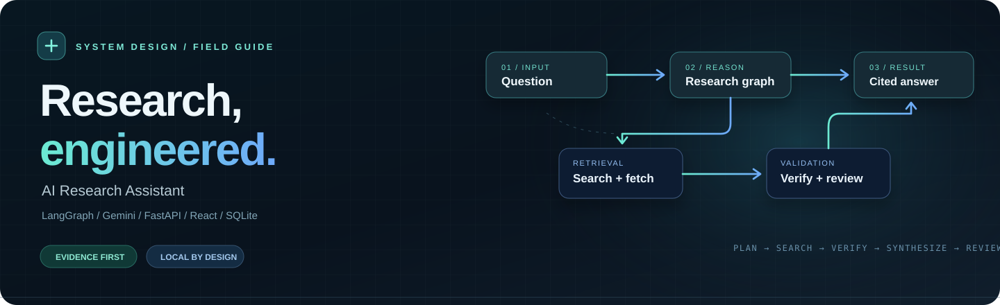
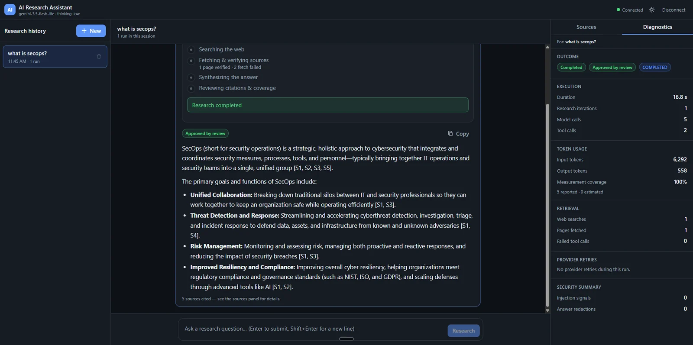
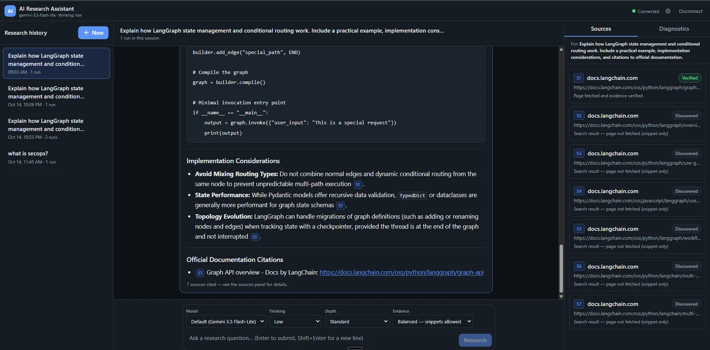
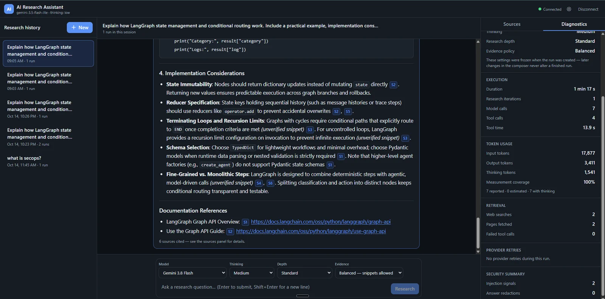
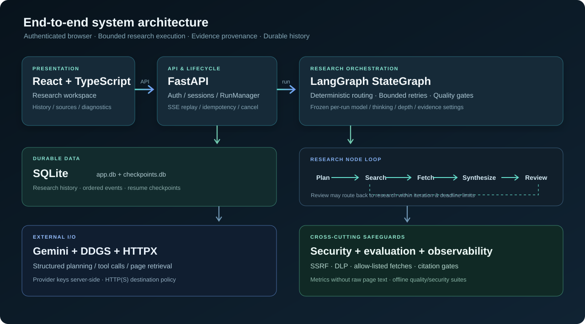
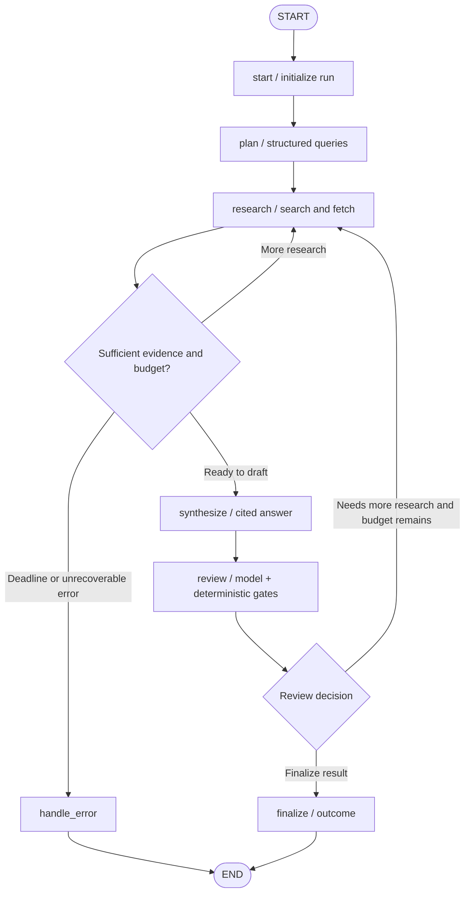
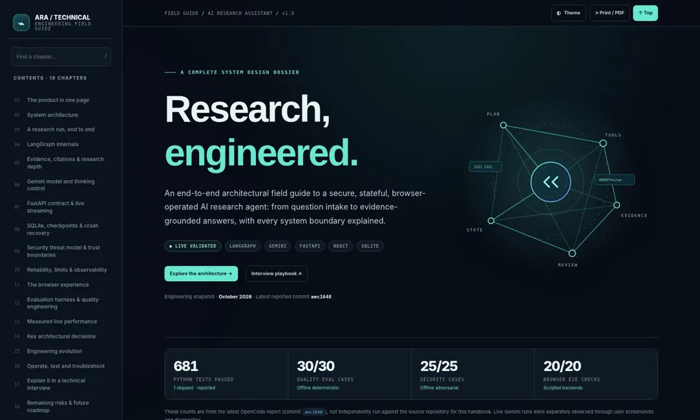

<p align="center">
  
</p>

<div align="center">

# AI Research Assistant

**A full-stack, evidence-grounded research agent — built to show its work.**

A local-first research workspace that **plans, searches, reads, cites, reviews, and remembers**. Powered by LangGraph and Gemini, with an authenticated FastAPI backend, React frontend, SQLite persistence, and security-aware tool execution.

**[Explore the architecture](#architecture)** &nbsp;·&nbsp; **[See the live UI](#product-tour)** &nbsp;·&nbsp; **[Run locally](#quick-start)** &nbsp;·&nbsp; **[Read the engineering handbook](#engineering-handbook)**


</div>

---

## At a glance

| | What makes it different |
|---|---|
| **Evidence, not just answers** | Sources are tagged as **retrieved** (page fetched and inspected) or **discovered** (search snippet only). Citation quality is enforced in the backend. |
| **Adaptive research** | Choose **Quick / Standard / Deep** investigation and **Balanced / Verified** evidence policy independently. |
| **Model-aware execution** | Choose a supported Gemini model and thinking setting for each run; configuration is **frozen when the run starts**. |
| **Inspectable workflow** | Stream planning, web searches, source verification, synthesis and review to the browser over authenticated SSE. |
| **Durability** | Browse completed research after a restart; SQLite checkpoints support conservative, at-least-once recovery of interrupted runs. |
| **Defensive engineering** | Fetch-target policy, SSRF mitigation, argument validation, prompt-injection signals, credential/DLP checks, bounded retries and structured outcomes. |

> **Project status:** A working **single-user localhost application**, not a production-hosted SaaS. Model availability, quota and billing depend on your Gemini project. A documented *free-tier eligible* model is **not** guaranteed available or free for every account.

## Product tour

The screenshots below are from real local browser tests—not mockups. Examples use LangGraph documentation and SecOps research.

<p align="center">
  
  <br /><sub><strong>01 — Research workspace.</strong> History · live research progress · answer · source inspector.</sub>
</p>

<table>
<tr>
<td width="50%" valign="top">
  
  <p align="center"><strong>02 — Technical research</strong><br /><sub>Explanations, runnable-style code and evidence-linked implementation notes.</sub></p>
</td>
<td width="50%" valign="top">
  
  <p align="center"><strong>03 — Transparent diagnostics</strong><br /><sub>Per-run outcome, provider settings, latency, token usage and retrieval.</sub></p>
</td>
</tr>
</table>

### Research controls

| Setting | Options | Behavior |
|---|---|---|
| Model | Backend-validated eligible Gemini catalogue | Selected per run; no silent model substitution. Availability is project-specific. |
| Thinking | Auto / Minimal / Low / Medium / High (when supported) | Uses model-specific `thinking_level` or thinking budget; unsupported combinations are rejected. |
| Depth | Quick / **Standard** / Deep | Controls retrieval quotas, source targets, plan/review guidance and answer depth; still subject to global deadline. |
| Evidence | **Balanced** / Verified | Balanced allows explicitly labeled snippet support; Verified requires retrieved evidence for factual citations. |

**Note:** “Verified” here refers to **retrieval/provenance**, not an independent guarantee that a source's claims are true. Longer responses are not automatically better research.

## Architecture

<p align="center">
  
</p>

<details>
<summary><strong>Expand the LangGraph execution graph</strong></summary>



This diagram is a **conceptual overview**. The exact edge conditions and error/deadline rules live in [`agent/routing.py`](agent/routing.py) and [`agent/graph.py`](agent/graph.py).

</details>

### One research request, end to end

1. **Create a run** — FastAPI validates the question, session, idempotency key, model, thinking, depth and evidence policy; saves a queued run.
2. **Plan** — Gemini creates a structured research plan. The LangGraph state carries the plan, findings and review status; budgets are resolved for the selected depth.
3. **Discover** — A bounded tool loop searches via `ddgs`; successful identical queries can be reused *within that invocation*, avoiding redundant backend searches.
4. **Retrieve** — `fetch_page` accepts only authorized URLs discovered by search in the run, applies network destination controls, content/size limits and evidence shaping.
5. **Synthesize** — The model drafts from bounded evidence using canonical `[S#]` citations. Snippet-only support is qualified, and the Verified policy can reject unsupported citations.
6. **Review** — LLM assessment is supplemented by deterministic citation, topic/deliverable, explanation-depth and official-source gates. It may send the run back to research within budget.
7. **Persist & stream** — SSE publishes sequenced, non-content progress events; the outcome, final redacted answer, source identifiers and diagnostics are stored in SQLite.
8. **Reopen** — History loads saved runs without re-invoking Gemini. Interrupted-node recovery uses checkpoints and may **repeat the interrupted step**.

### Code map

| Path | Responsibility |
|---|---|
| [`agent/graph.py`](agent/graph.py) · [`agent/state.py`](agent/state.py) · [`agent/routing.py`](agent/routing.py) | LangGraph nodes, state/reducers, bounded conditional routing, synthesis and review |
| [`agent/tools.py`](agent/tools.py) · [`agent/citations.py`](agent/citations.py) | Search, hardened page retrieval, source identifiers and evidence validation |
| [`agent/depth.py`](agent/depth.py) · [`agent/completeness.py`](agent/completeness.py) | Depth policy, topic/deliverable checks and structural code-example gate |
| [`agent/gemini_models.py`](agent/gemini_models.py) · [`agent/llm.py`](agent/llm.py) | Gemini capability registry, per-run model configuration and provider failure handling |
| [`app/api.py`](app/api.py) · [`app/runs.py`](app/runs.py) · [`app/events.py`](app/events.py) | Authenticated REST API, run lifecycle, streaming/replay and persistence orchestration |
| [`app/db.py`](app/db.py) · [`app/repository.py`](app/repository.py) | SQLite persistence, sessions, run metadata and schema migrations |
| [`frontend/src/`](frontend/src/) | React browser UI, safe Markdown, session navigation, sources and diagnostics |
| [`evals/`](evals/) · [`tests/`](tests/) · [`frontend/e2e/`](frontend/e2e/) | Offline evaluation fixtures, Python tests and mocked full-browser Playwright scenarios |

## Measured local runs

The following figures were observed in browser tests using the **same technical research question**. They illustrate that model and thinking selection operate end to end; they are **not controlled benchmark results**.

| Metric | Gemini 3.5 Flash-Lite | Gemini 3.8 Flash |
|---|---:|---:|
| Thinking setting | Low | Medium |
| Time | **32.1 s** | 77 s |
| Model calls | 7 | 7 |
| Tool calls | 3 | 4 |
| Input tokens | 14,392 | 17,877 |
| Output tokens | 2,148 | 3,411 |
| Thinking tokens reported | Not reported | 1,541 |
| Retrieved pages | 1 | 2 |
| Reviewer | Approved | Approved |
| Usage metadata coverage | 100% | 100% |

Runtime, retrieval and output vary with query selection, provider latency, model generation and thinking effort. **Don't use these two runs to claim one model is universally better.** Token-coverage percentage describes reported metadata, not a guarantee about billing.

## Quick start

### Windows — browser app (recommended)

**Prerequisites:** Python 3.12+ (development tested with Python 3.14), Node.js/npm for the first frontend build, and a Gemini API key. A compatible Python version and package availability depend on your environment.

```powershell
# Clone your authorized copy of the repository
git clone https://github.com/meetsinghit/langgraph-ai-research-assistant.git
cd langgraph-ai-research-assistant

# Create the virtual environment expected by the launchers
python -m venv ai_poc
.\ai_poc\Scripts\python.exe -m pip install -r requirements.txt

# Set credentials privately (NEVER commit .env)
Copy-Item .env.example .env
notepad .env

# First-time frontend build
cd frontend
npm ci
npm run build
cd ..
```

Add `GEMINI_API_KEY` to `.env` using your own key from [Google AI Studio](https://aistudio.google.com/apikey). Keep the configured `LLM_MODEL` if you want to preserve the default.

**To launch:** Double-click **`start-research-assistant.bat`**. The app serves on [`http://127.0.0.1:8000`](http://127.0.0.1:8000) by default. The launcher can copy your local UI access token to the clipboard; paste it into the browser connection dialog. To stop, double-click **`stop-research-assistant.bat`**.

**Never commit** `.env`, `data/`, databases, log files, API tokens or personal research content. The `.gitignore` excludes these by default.

### CLI or development server

```powershell
# From the project root, with the venv installed
.\ai_poc\Scripts\python.exe main.py "Explain conditional routing using official documentation"

# Direct backend for local development
.\ai_poc\Scripts\python.exe -m app.main
```

For a separate Vite dev frontend, use `cd frontend`, then `npm run dev`. See the [operations guide](docs/OPERATIONS.md) for configuration, launch, restart, data backups and troubleshooting.

<details>
<summary><strong>Docker assets (not runtime-verified in the reported environment)</strong></summary>

`docker/Dockerfile` and `docker/docker-compose.yml` are included, but the original development machine did **not** have Docker installed, so a real container build and smoke test remain outstanding.

```bash
docker compose -f docker/docker-compose.yml up -d --build
```

Do not expose the container publicly without additional authentication, TLS and network security review.
</details>

## Security & trust boundaries

> **Threat model:** External webpages, snippets and tool responses are **untrusted evidence**, never privileged instructions.

| Boundary | Implemented controls | Important limitation |
|---|---|---|
| User/browser → API | Bearer token, input schema validation, per-run immutable config and localhost binding | Single-user local authentication; **not** a public multi-tenant security model |
| Model → tools | Allow-listed tool schemas/arguments, bounded budgets, destination authorization, DLP checks | Tool/LLM errors and adversarial behavior still require real-world monitoring |
| Network fetch → graph | Scheme/port/IP validation, redirect policy, TLS verification, content and response-size limits | Residual DNS/HTTPS connection and network-environment risks documented |
| Untrusted source → LLM | Explicit source boundaries, injection signals, content shaping and provenance labels | Pattern signals **do not prove** resistance to every prompt injection |
| Draft → answer | Citation IDs, evidence-policy rules, quality review, output redaction | “Retrieved” is a provenance label, **not** factual certification |
| Graph → persistence | Authenticated sessions, checkpoint pruning, content-restricted SSE/metrics | Database deletion does **not** guarantee secure physical erasure |

See [security architecture and residual risks](docs/SECURITY.md). Do not put client-confidential data, company secrets or private credentials into a public demo.

## Validation & engineering practices

**Latest reported validation at commit `aec1648`** (from the project development logs; **not independently rerun for this documentation pack**):

| Gate | Reported result |
|---|---:|
| Python full suite | **681 passed, 1 skipped** |
| Offline research quality | **30 / 30** |
| Offline adversarial security | **25 / 25** |
| React / TypeScript unit tests | **107 / 107** |
| Full-browser Playwright E2E | **20 / 20** |
| Frontend typecheck and build | Passed |
| Windows launcher smoke | Passed |

Mocked evaluations test specified controls and failure scenarios, not production-grade security or live-model persuasion resistance. Selected features were separately exercised in manual live browser tests. The reported test counts may evolve with later commits.

Run the offline gates after installing dependencies:

```powershell
.\ai_poc\Scripts\python.exe -m pytest -q
.\ai_poc\Scripts\python.exe -m evals
.\ai_poc\Scripts\python.exe -m evals --security
cd frontend
npm run typecheck
npm test
npm run build
```

## Engineering handbook

**[Open the complete technical handbook (HTML)](docs/technical-handbook.html)** — a self-contained, interactive deep dive into the architecture, LangGraph state, research/evidence flow, API/data contracts, security controls, decisions, real runs, evaluations and interview questions.

<p align="center"><a href="docs/technical-handbook.html"></a></p>

**To use the interactive version:** Download the HTML from GitHub (**Raw → Save**) and open it in Chrome or Edge. GitHub's file viewer will display source code rather than running its JavaScript. The HTML is self-contained and does not need an API key or server.

More references: [Operations](docs/OPERATIONS.md) · [Security design](docs/SECURITY.md) · [Project walkthrough](docs/PORTFOLIO_STORY.md) · [Public-release checklist](docs/GITHUB_PUBLICATION_REVIEW.md).

## Known limitations

- A model listed as free-tier eligible may be unavailable or billable under a particular Google project; discovery is opt-in and cannot certify cost.
- DDGS search reliability/latency varies with network and upstream providers; global deadlines are **cooperative**, not process-kill hard limits.
- Snippet-supported citations in Balanced mode are weaker than fetched page evidence. Grounding, completeness and code-example checks remain heuristics.
- LangGraph recovery is **at-least-once at interrupted-node granularity**; replay of an interrupted side-effect is possible.
- Single-user localhost auth, Docker runtime, full live adversarial resistance and multi-user/public deployment require more work.

## Responsible sharing

This is a technical learning and portfolio project, not a commercial or production security guarantee. **No license has been selected yet**; that means public visibility alone does *not* grant permission to reuse the code. Review [publication readiness](docs/GITHUB_PUBLICATION_REVIEW.md) before making the repository public, including any employer IP policies, embedded secrets in **Git history**, licensing and third-party assets.

---

<div align="center">

**Built to turn research into a traceable engineering workflow.**

<sub>LangGraph · Gemini · FastAPI · React · SQLite &nbsp;|&nbsp; Local-first, evidence-aware, test-driven.</sub>

</div>
